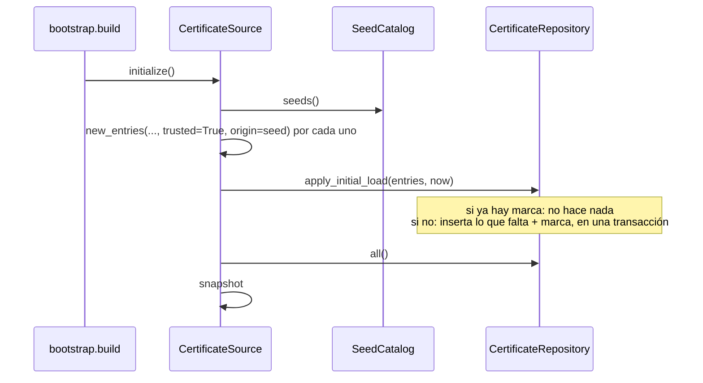

# Casos de uso

Un caso de uso es una operación de negocio: recibe lo que pide quien la usa, aplica las reglas del [dominio](dominio.md) y usa el exterior sólo a través de [puertos](puertos.md). Están en `application/use_cases/` y no saben de HTTP: los endpoints de `routers/` traducen el pedido, llaman al caso de uso y arman la respuesta (presenters).

> Este documento crece con la migración. Hoy tiene la fuente de certificados (paso 3). La extracción e inspección de certificados, la validación y la firma siguen en `services/` y se agregan en sus pasos.

| Caso de uso | Endpoints | Puertos |
|-------------|-----------|---------|
| [`CertificateSource`](#certificatesource-la-fuente-de-certificados) | `/store/certificates*` (y el snapshot que leen `/verify`, `/certificates` y `/certificates/inspect`) | `CertificateRepository`, `CertificateCodec`, `SeedCatalog`, `Clock` |

## `CertificateSource`: la fuente de certificados

`application/use_cases/certificate_source.py`. Administra la fuente (ABM y carga inicial) y le da al validador su snapshot. Las reglas F-01 a F-06 están en [dominio.md](dominio.md#reglas) e [invariantes.md](invariantes.md#fuente-de-certificados-f).

**Estado en memoria.** Guarda el `TrustSnapshot` vigente y lo reemplaza entero después de cada cambio (`_reload`, bajo un lock para que una recarga vieja no pise a una nueva). `snapshot()` no bloquea; todo lo demás sí, porque usa el repositorio. La copia es de cada proceso: con varios workers, un cambio sólo llega al proceso que lo atendió. La PoC corre con un solo worker.

**Ciclo de vida.** `bootstrap.build` lo crea y llama a `initialize()` una vez, al arrancar. Antes de eso el snapshot está vacío.

### Operaciones

| Operación | Entrada | Salida | Reglas | Errores (HTTP) |
|-----------|---------|--------|--------|----------------|
| `initialize()` | — | — | F-04: aplica la carga inicial si nunca se aplicó, y carga el snapshot. | `UnprocessableCertificate` si un certificado de la carga inicial no es una CA (error de empaquetado: la app no arranca). |
| `snapshot()` | — | `TrustSnapshot` | F-05, F-06 | — |
| `list(kind=None)` | `CaKind` opcional | `list[StoredCertificate]` | Raíces primero, cada grupo por sujeto. | — |
| `summary()` | — | `SourceSummary` | Cuenta lo que usa el validador. | — |
| `get(id)` | id | `StoredCertificate` | — | `CertificateNotFound` (404) |
| `add(data, trusted, notes, origin)` | DER, PEM, PKCS#7 o base64 | `AddResult` | F-01, F-02, F-03; recarga el snapshot. | `UnprocessableCertificate` (422): no es un certificado, o alguno no es CA. `DuplicateCertificate` (409): ya estaban todos. |
| `update(id, changes)` | id, `EntryChanges` | `StoredCertificate` | F-02; sin cambios no toca nada (ni `updated_at`); recarga el snapshot. | `CertificateNotFound` (404), `UnprocessableInput` (422): confiar en un intermedio. |
| `delete(id)` | id | — | Recarga el snapshot. | `CertificateNotFound` (404) |
| `restore_seed()` | — | `list[StoredCertificate]` (los agregados) | F-04: sólo lo que falta. | — |

Las horas (`created_at`, `updated_at`) salen del `Clock`. El repositorio las guarda al segundo.

### Alta, paso a paso

```mermaid
sequenceDiagram
    participant R as routers/store.py
    participant S as CertificateSource
    participant C as CertificateCodec
    participant D as domain/source.py
    participant Repo as CertificateRepository
    R->>S: add(data, trusted, notes, origin)
    S->>C: parse(data)
    C-->>S: [Certificate]  (o UnprocessableCertificate)
    S->>D: new_entries(certs, trusted, notes, origin)
    D-->>S: [NewEntry]  (F-01: o UnprocessableCertificate; F-02: trusted sólo en raíces)
    S->>Repo: insert_missing(entries, clock.now())
    Repo-->>S: (agregadas, ya estaban)  — atómico
    alt no se agregó nada
        S-->>R: DuplicateCertificate(ids)  (F-03)
    else
        S->>Repo: all()
        S->>S: snapshot = TrustSnapshot.from_entries(...)  (F-05)
        S-->>R: AddResult
    end
    R->>R: present(entrada, clock.now())  → JSON
```

### Carga inicial



La carga inicial pide `trusted=True` para todos sus certificados; F-02 hace que la AC ONTI, que es intermedia, quede no confiable.

### Presentación (HTTP)

`routers/store.py` arma el JSON con `present(entrada, now)`: los campos del certificado (`sha256`, `subject`, `issuer`, `not_before`, `not_after`, `der_b64`), los de la entrada (`id`, `kind`, `trusted`, `enabled`, `origin`, `notes`, `created_at`, `updated_at`) y `validity_status`, que se calcula con la hora del `Clock` de la app. El router también resuelve lo que es propio de HTTP: exigir uno solo de `crt` o `b64`, y llevar el alta fuera del event loop (`run_in_threadpool`), porque bloquea.

Tests: `tests/test_certificate_source.py` (con fakes), `tests/test_store.py` (por HTTP), goldens `store_*`.
