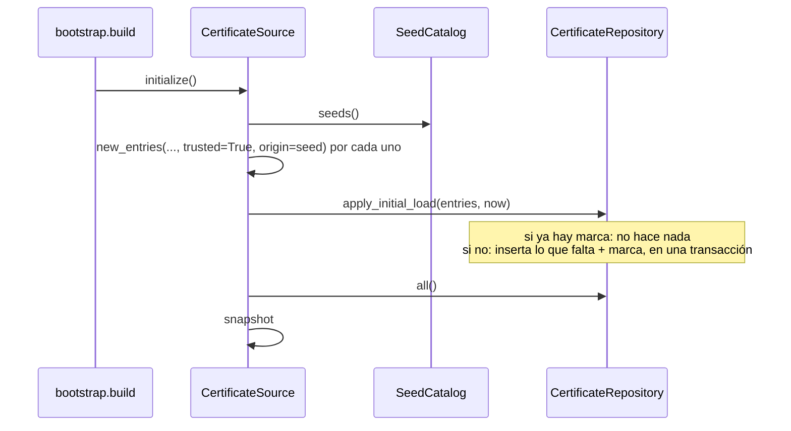
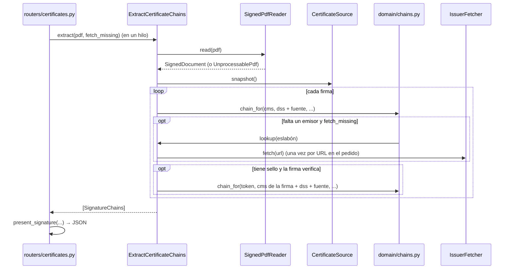

# Casos de uso

Un caso de uso es una operación de negocio: recibe lo que pide quien la usa, aplica las reglas del [dominio](dominio.md) y usa el exterior sólo a través de [puertos](puertos.md). Están en `application/use_cases/` y no saben de HTTP: los endpoints de `routers/` traducen el pedido, llaman al caso de uso y arman la respuesta (presenters).

> Este documento crece con la migración. Hoy tiene la fuente de certificados (paso 3) la extracción e inspección de certificados (paso 4) y la validación (paso 5). La firma sigue en `services/` y se agrega en su paso.

| Caso de uso | Endpoints | Puertos |
|-------------|-----------|---------|
| [`CertificateSource`](#certificatesource-la-fuente-de-certificados) | `/store/certificates*` (y el snapshot que leen `/verify`, `/certificates` y `/certificates/inspect`) | `CertificateRepository`, `CertificateCodec`, `SeedCatalog`, `Clock` |
| [`ExtractCertificateChains`](#extractcertificatechains-la-cadena-de-cada-firma) | `POST /certificates` | `SignedPdfReader`, `CertificateCodec`, `IssuerFetcher` (y el snapshot de `CertificateSource`) |
| [`InspectCertificates`](#inspectcertificates-el-detalle-de-un-certificado) | `POST /certificates/inspect` | `CertificateCodec` (y el snapshot de `CertificateSource`) |
| [`VerifySignatures`](#verifysignatures-validar-las-firmas-de-un-pdf) | `POST /verify` | `SignatureValidator`, `Clock` (y el snapshot de `CertificateSource`) |

## `CertificateSource`: la fuente de certificados

`application/use_cases/certificate_source.py`. Administra la fuente (ABM y carga inicial) y le da al validador su snapshot. Las reglas F-01 a F-06 están en [dominio.md](dominio.md#reglas) e [invariantes.md](invariantes.md#fuente-de-certificados-f).

**Estado en memoria.** Guarda el `TrustSnapshot` vigente y lo reemplaza entero después de cada cambio (`_reload`, bajo un lock para que una recarga vieja no pise a una nueva). `snapshot()` no bloquea; todo lo demás sí, porque usa el repositorio. La copia es de cada proceso: con varios workers, un cambio sólo llega al proceso que lo atendió. La PoC corre con un solo worker.

**Ciclo de vida.** `bootstrap.build` lo crea y llama a `initialize()` una vez, al arrancar. Antes de eso el snapshot está vacío.

### Operaciones

| Operación | Entrada | Salida | Reglas | Errores (HTTP) |
|-----------|---------|--------|--------|----------------|
| `initialize()` | — | — | F-04: aplica la carga inicial si nunca se aplicó, y carga el snapshot. | `UnprocessableCertificate` si un certificado de la carga inicial no es una CA (error de empaquetado: la app no arranca). |
| `snapshot()` | — | `TrustSnapshot` | F-05, F-06 | — |
| `list(kind=None)` | `CaKind` opcional | `list[StoredCertificate]` | Raíces primero, cada grupo por sujeto. | — |
| `summary()` | — | `SourceSummary` | Cuenta lo que usa el validador. | — |
| `get(id)` | id | `StoredCertificate` | — | `CertificateNotFound` (404) |
| `add(data, trusted, notes, origin)` | DER, PEM, PKCS#7 o base64 | `AddResult` | F-01, F-02, F-03; recarga el snapshot. | `UnprocessableCertificate` (422): no es un certificado, o alguno no es CA. `DuplicateCertificate` (409): ya estaban todos. |
| `update(id, changes)` | id, `EntryChanges` | `StoredCertificate` | F-02; sin cambios no toca nada (ni `updated_at`); recarga el snapshot. | `CertificateNotFound` (404), `UnprocessableInput` (422): confiar en un intermedio. |
| `delete(id)` | id | — | Recarga el snapshot. | `CertificateNotFound` (404) |
| `restore_seed()` | — | `list[StoredCertificate]` (los agregados) | F-04: sólo lo que falta. | — |

Las horas (`created_at`, `updated_at`) salen del `Clock`. El repositorio las guarda al segundo.

### Alta, paso a paso

```mermaid
sequenceDiagram
    participant R as routers/store.py
    participant S as CertificateSource
    participant C as CertificateCodec
    participant D as domain/source.py
    participant Repo as CertificateRepository
    R->>S: add(data, trusted, notes, origin)
    S->>C: parse(data)
    C-->>S: [Certificate]  (o UnprocessableCertificate)
    S->>D: new_entries(certs, trusted, notes, origin)
    D-->>S: [NewEntry]  (F-01: o UnprocessableCertificate; F-02: trusted sólo en raíces)
    S->>Repo: insert_missing(entries, clock.now())
    Repo-->>S: (agregadas, ya estaban)  — atómico
    alt no se agregó nada
        S-->>R: DuplicateCertificate(ids)  (F-03)
    else
        S->>Repo: all()
        S->>S: snapshot = TrustSnapshot.from_entries(...)  (F-05)
        S-->>R: AddResult
    end
    R->>R: present(entrada, clock.now())  → JSON
```

### Carga inicial



La carga inicial pide `trusted=True` para todos sus certificados; F-02 hace que la AC ONTI, que es intermedia, quede no confiable.

### Presentación (HTTP)

`routers/store.py` arma el JSON con `present(entrada, now)`: los campos del certificado (`sha256`, `subject`, `issuer`, `not_before`, `not_after`, `der_b64`), los de la entrada (`id`, `kind`, `trusted`, `enabled`, `origin`, `notes`, `created_at`, `updated_at`) y `validity_status`, que se calcula con la hora del `Clock` de la app. El router también resuelve lo que es propio de HTTP: exigir uno solo de `crt` o `b64`, y llevar el alta fuera del event loop (`run_in_threadpool`), porque bloquea.

Tests: `tests/test_certificate_source.py` (con fakes), `tests/test_store.py` (por HTTP), goldens `store_*`.

## `ExtractCertificateChains`: la cadena de cada firma

`application/use_cases/certificate_chains.py`. Por cada firma del PDF (incluidos los DocTimeStamp), su integridad y, si verifica, la cadena de su firmante; y para cada firma con sello de tiempo, lo mismo para la TSA. No exige confianza. Las reglas C-01 a C-03 están en [dominio.md](dominio.md#cadenas-domainchainspy).

**Bloquea**: puede descargar emisores por AIA. El router lo llama con `run_in_threadpool`.

| Entrada | Salida | Errores (HTTP) |
|---------|--------|----------------|
| `pdf` (bytes), `fetch_missing` (bool) | `list[SignatureChains]`: por firma, `field_name`, `kind`, `chain` (`ChainResult`) y `timestamp` (`TimestampChain`: hora y `ChainResult`, o `None`) | `UnprocessablePdf` (422): el PDF no tiene firmas |

### Qué candidatos tiene cada cadena

| Cadena | Candidatos, en orden de precedencia |
|--------|------------------------------------|
| Firma (o DocTimeStamp) | firmante y demás certificados de su CMS (`cms`) → DSS (`dss`) → fuente, habilitados (`store`) → AIA si `fetch_missing` (`aia`) |
| Sello de la firma | firmante y demás certificados del token (`cms`) → demás certificados del CMS de la **firma** (`cms`) → DSS → fuente → AIA |

El sello de una firma se analiza sólo si la firma verifica (C-01): si el documento se alteró, no hay un valor de firma confiable que el sello pueda cubrir.

### Paso a paso



### Presentación (HTTP)

`routers/certificates.py::present_signature` arma, por firma, `field`, `type` y los campos de la cadena: `crypto_valid`, `intact`, `valid` y, si no verifica, `error` y `certificates: null`; si verifica, `chain_complete`, `certificates` y, si hubo, `aia_errors`. Las firmas (no los DocTimeStamp) llevan además `signature_timestamp` (`null` si no tiene o si la firma no verifica). Cada certificado: `type` (`end_entity` en la posición 0, `root` si es autofirmado, si no `intermediate`), `source`, `self_signed`, `subject`, `issuer`, `serial_number` (hex), vigencia, `sha256_fingerprint`, `der_b64` e `in_store`.

Tests: `tests/test_extract_chains.py` (con fakes), `tests/test_certificates.py` (por HTTP), goldens `certificates_*`.

## `InspectCertificates`: el detalle de un certificado

`application/use_cases/inspect_certificates.py`. El detalle legible de los certificados recibidos (uno, o todos los de un PKCS#7, en orden) y si cada uno ya está en la fuente. No hace E/S.

| Entrada | Salida | Errores (HTTP) |
|---------|--------|----------------|
| `data`: DER, PEM, PKCS#7 o base64 de un DER | `list[InspectedCertificate]`: `certificate`, `details` (`CertificateDetails`) e `in_store` | `UnprocessableCertificate` (422) |

El router exige uno solo de `crt` (archivo) o `b64` (texto) y arma el JSON con `present_inspected`: los campos del certificado y del detalle, `validity` con `status` y `days_left` calculados con el `Clock` de la app, las huellas y `in_store`.

Tests: `tests/test_inspection.py` (por HTTP), goldens `inspect_*`.

## `VerifySignatures`: validar las firmas de un PDF

`application/use_cases/verify_signatures.py`. Valida cada firma con el material del PDF (CMS y DSS) y la fuente de certificados; con conexión, además con lo que descargue. Las reglas V-01 a V-10 están en [dominio.md](dominio.md#validación-domainverificationpy) e [invariantes.md](invariantes.md#validación-v).

**Async**: con conexión descarga CRL, OCSP y emisores. El router lo llama con `await`.

| Entrada | Salida | Errores (HTTP) |
|---------|--------|----------------|
| `pdf` (bytes), `VerificationOptions` | `VerificationReport` | `UnprocessableInput` (422): con conexión y hora declarada (V-04). `UnprocessablePdf` (422): el PDF no tiene firmas (V-10). Valores de opciones desconocidos: 422 de FastAPI. |

`trust_roots(snapshot=None)` devuelve las anclas (V-01). `verify` lo usa con el snapshot que ya tomó, así anclas e intermedios salen del mismo estado de la fuente (F-05).

### Paso a paso

```mermaid
sequenceDiagram
    participant R as routers/verification.py
    participant U as VerifySignatures
    participant S as CertificateSource
    participant D as domain/verification.py
    participant V as SignatureValidator
    R->>U: verify(pdf, options)
    U->>D: options.check()  (V-04)
    U->>S: snapshot()
    U->>D: trust_anchors, legacy_sha1_roots  (V-01, V-02)
    U->>V: open(pdf, ValidationPolicy)
    V-->>U: sesión  (o UnprocessablePdf, V-10)
    loop cada firma
        alt DocTimeStamp
            U->>U: se lista, no se valida
        else firma
            opt validation_time = claimed_signing_time
                U->>V: claimed_signing_time(firma)
            end
            U->>D: validation_moment  (V-08)
            U->>V: evaluate(firma, ValidatedAt)
            V-->>U: SignatureEvaluation
            U->>D: trust_problem, completed_from_store  (V-09, V-06; firma y sello)
        end
    end
    U->>V: fetched()  (con conexión)
    U->>D: pades_level  (V-05, V-07)
    U-->>R: VerificationReport
    R->>R: present_report(...)  → JSON
```

La hora declarada sólo se lee si se pidió validar a esa hora.

### Presentación (HTTP)

`routers/verification.py::present_report` arma el JSON:

| Campo | De dónde sale |
|-------|---------------|
| `validation_time`, `diff_policy`, `revocation` | Las opciones, con su nota o advertencia; `revocation.fetched` con lo descargado (CRL: emisor, vigencia, si salió del caché y cuándo se descargó; OCSP: serie en hex, estado y fecha; emisores: nombre y huella). |
| `pades_level` | `VerificationReport.pades_level`. |
| `dss` | `{"Certs", "OCSPs", "CRLs"}`, o `null` sin DSS. |
| `certificate_store` | `trusted_roots` (cantidad de anclas, incluida la implícita), `intermediates`, `self_contained` y `note`. |
| `signatures` | Por firma: `field`, `type`, `subfilter`, `signer` (nombre para mostrar), `bottom_line`, `intact`, `valid`, `trusted`, `trust_problem`, `coverage`, `completed_from_store`, `modifications`, `validated_at`, `signature_timestamp` y `details`. Un DocTimeStamp sólo lleva `field` y `type`. |

En `trust_problem.paths`, cada eslabón se muestra con su CN (o el nombre completo si no tiene), su vencimiento y su huella: una CA renovada tiene el mismo nombre en los dos caminos.

Tests: `tests/test_verify_signatures.py` (con un validador falso), `tests/test_verify.py`, `tests/test_verify_online.py` y `tests/test_store.py` (por HTTP), goldens `verify_*`.
